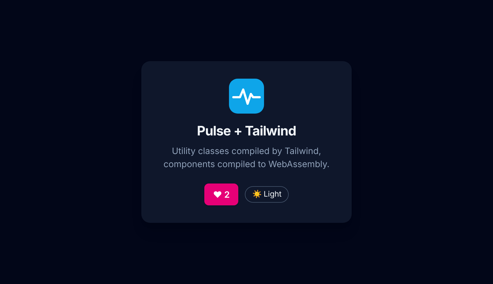
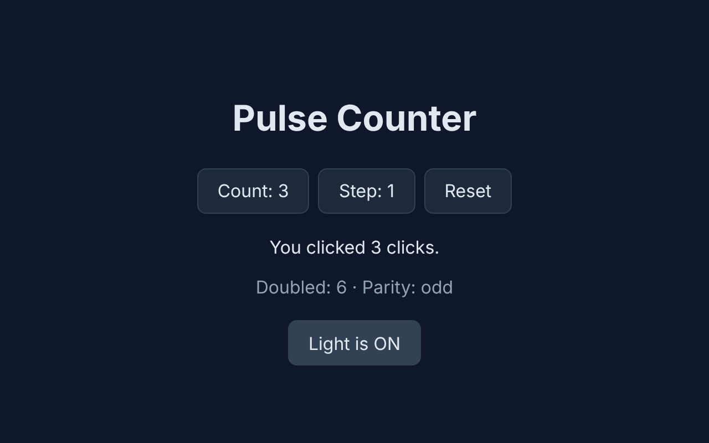

# Pulse

**Write components in TypeScript + JSX. Ship WebAssembly.**

Pulse is a frontend framework with a familiar React-like authoring experience
(`.tsx` files, JSX, typed components) whose compiler, written in Rust, turns
your application into a WebAssembly module that drives the DOM directly.
Reactivity is built in: no virtual DOM, no diffing, no state-management library.
When a signal changes, Pulse updates exactly the text nodes and attributes
that read it.

```tsx
import { signal } from "pulse";

const count = signal<number>(0);

export default function App(): JSX.Element {
  return (
    <button onClick={() => count.value++}>
      Count: {count.value}
    </button>
  );
}
```

```bash
pulse dev src/App.tsx      # develop: http://localhost:3000, hot reload on save
pulse build src/App.tsx    # ship: dist/ = index.html + app.wasm + a small loader
```

The production build is plain static files: host it on any web server or CDN.

Pulse is **frontend-only and backend-agnostic**. It doesn't care what your
server is written in; your app talks to backends through standard web APIs.

> **Status:** early development. Milestone 1 (TSX → WASM → reactive DOM) works
> and is tested; see [Status](#status). Anything marked *planned* in this
> README doesn't exist yet.

---

## Why Pulse?

| | |
|---|---|
| **Familiar** | TSX syntax, function components, `onClick={...}`. If you know React or Solid, you already know how to read Pulse code. |
| **Type-safe** | Pulse apps are TypeScript. The compiler type-checks your code (`number`, `string`, `boolean`, `Signal<T>`, ...) and maps it to real Rust types. Type errors are compile errors, with the exact line and column. |
| **Fast by construction** | Components run once. The compiler knows which parts of the UI are static and which depend on signals, so static markup is created once and only the dynamic parts get fine-grained effects. |
| **Small surface** | Five primitives: `signal`, `computed`, `effect`, `batch`, `untrack`. |
| **No backend lock-in** | It's just a static bundle. Host it anywhere. |

---

## Getting started

### 1. Install

You need Rust with the WebAssembly target:

```bash
rustup target add wasm32-unknown-unknown
```

Then install the `pulse` CLI from this repository:

```bash
cargo install --path crates/pulse-cli
```

*(Planned: a published release, so this becomes `cargo install pulse-cli`.)*

### 2. Create an app

A Pulse app is a folder with a TSX entry file:

```text
my-app/
├── src/
│   ├── App.tsx        # your root component (export default)
│   └── styles.css     # optional; imported from App.tsx
├── public/            # optional; images, fonts, favicons, copied as-is
├── index.html         # optional; a default page is generated if missing
├── package.json       # optional; only for npm packages such as Tailwind
└── tsconfig.json      # optional; for editor type-checking (see below)
```

`src/App.tsx`:

```tsx
import { signal, computed } from "pulse";

const count = signal<number>(0);
const doubled = computed(() => count.value * 2);

export default function App(): JSX.Element {
  return (
    <main class="app">
      <h1>Hello, Pulse</h1>
      <button onClick={() => count.value++}>Clicked {count.value} times</button>
      <p>Doubled: {doubled.value}</p>
    </main>
  );
}
```

*(Planned: `pulse new my-app` to scaffold this.)*

### 3. Develop with hot reload

```bash
pulse dev src/App.tsx
```

Open <http://localhost:3000>. Each time you save:

* the app is recompiled (about 0.3 s for the example) and the new WebAssembly
  module is **swapped into the open page without a reload**;
* **global signal state is kept**: if you clicked a counter up to 5 and then
  edit the component, it is still 5. Component-local state starts fresh;
* a compile error appears as an **overlay in the browser** (and in the
  terminal) with file, line and column. It disappears once you fix it;
* editing `index.html` reloads the page.

If only stylesheets changed, just `app.css` is swapped. The app keeps running
untouched, local state included.

The dev server is part of the `pulse` binary (Rust standard library only), so
no extra tools are needed.

### 4. Build for production

```bash
pulse build src/App.tsx --out dist
```

```bash
pulse serve dist           # preview the production build locally
```

`dist/` contains only static files. Deploy them to any static host (nginx,
S3, Netlify, GitHub Pages, ...). The only requirement is that `.wasm` is served
as `application/wasm`, which all common hosts do.

### Styling

Pulse treats CSS like the rest of the build: import it, and it's bundled into
`app.css` and linked from the page automatically.

**Plain CSS:**

```tsx
import "./styles.css";
```

**A CSS framework from npm** (Bootstrap, Pico, Bulma, Open Props, ...).
Bare specifiers resolve from `node_modules`:

```bash
npm install @picocss/pico
```

```tsx
import "@picocss/pico/css/pico.min.css";
```

**Tailwind CSS:** install it once:

```bash
npm install -D tailwindcss @tailwindcss/cli
```

Create a stylesheet that imports Tailwind and import it from your app:

```css
/* src/styles.css */
@import "tailwindcss";
```

```tsx
import "./styles.css";

export default function App(): JSX.Element {
  return <h1 class="text-3xl font-bold text-sky-600">Hello</h1>;
}
```

That's all: no config file and no plugin. Pulse notices `@import
"tailwindcss"` and runs the Tailwind CLI, which picks up the classes used in
your `.tsx` files, including ones switched by signals
(`class={on.value ? "bg-pink-600" : "bg-slate-900"}`). In `pulse dev`, new
classes show up on save; production builds are minified. Tailwind runs in
parallel with the WebAssembly build, so it adds no build time. See
[`examples/tailwind`](examples/tailwind):



**Static assets:** files in `public/` are copied to the output root, so
`public/logo.svg` is served as `logo.svg`.

**CDN stylesheets:** a `<link>` in your `index.html` works as usual.

### Editor support

Pulse ships TypeScript declarations in [`types/pulse.d.ts`](types/pulse.d.ts),
so VS Code (or `tsc --noEmit`) understands `import { signal } from "pulse"` and
JSX. Point your `tsconfig.json` at them:

```json
{
  "compilerOptions": {
    "strict": true,
    "jsx": "preserve",
    "noEmit": true,
    "paths": { "pulse": ["../../types/pulse.d.ts"] }
  },
  "include": ["src", "../../types"]
}
```

Code that the Pulse compiler accepts also type-checks with `tsc`.

---

## The reactive model

### `signal`: reactive state

```tsx
const name = signal<string>("world");   // explicit type
const count = signal(0);                // inferred: Signal<number>

count.value;        // read (inside JSX/computed/effect this subscribes)
count.value = 5;    // write
count.value++;      // update
name.value += "!";  // string append
```

Signals declared at module level are **global shared state**; any component
can use them. Signals declared inside a component are **local state**:

```tsx
function Toggle(): JSX.Element {
  const on = signal(false);               // local to this component
  return <button onClick={() => on.value = !on.value}>{on.value ? "ON" : "OFF"}</button>;
}
```

### `computed`: derived values

```tsx
const price = signal(20);
const qty = signal(3);
const total = computed(() => price.value * qty.value);   // Computed<number>
```

Computed values are lazy and cached. They recalculate only when read after a
dependency changed. They are read-only: assigning `total.value = 1` is a compile
error.

### `effect`: side effects

```tsx
effect(() => {
  console.log("count is now " + count.value);
});
```

Runs immediately, then again whenever anything it read changes. Dependencies
are tracked automatically, including conditional ones.

### `batch`: grouped updates

```tsx
batch(() => {
  price.value = 25;
  qty.value = 4;
});   // effects run once here, not twice
```

Event handlers are batched automatically.

### `untrack`: read without subscribing

```tsx
effect(() => {
  console.log(count.value + " (step is " + untrack(() => step.value) + ")");
});
```

---

## Components and JSX

* A component is a function returning `JSX.Element`. The root component is
  the module's `export default function` (or a function named `App`).
* Use components as tags: `<Header />`.
* Attributes: `class="..."` (or `className`), dynamic `title={expr}`, boolean
  `disabled={isBusy.value}`.
* Events: `onClick`, `onInput`, `onMouseEnter`, ... take a function:
  `onClick={() => ...}` or `onClick={handler}`.
* Text: `{expr}` renders numbers and strings; adjacent text is merged into one
  DOM text node.
* Fragments `<>...</>` are allowed inside elements.

Plain helper functions work too, with typed parameters:

```tsx
function label(n: number): string {
  if (n === 1) {
    return "1 item";
  }
  return n + " items";
}
```

---

## How it works

```text
App.tsx ──► Lexer/Parser ──► AST ──► Type checker ──► Typed IR ──► Optimizer ──► Rust codegen ──► cargo (wasm32) ──► app.wasm
                                                                                                                       │
                                                         Browser:  index.html ─► pulse.js loader ─► instantiate ◄──────┘
                                                                                     ▲      │
                                                                         DOM calls   │      ▼  events
                                                                                  pulse-runtime (signals + DOM bindings)
```

* **`crates/pulse-compiler`**: a pure library (no I/O, no external
  dependencies). It parses TSX, checks TypeScript types, lowers JSX to a DOM
  tree IR, optimizes it (constant folding, text merging, static vs. reactive
  analysis), and emits Rust.
* **`crates/pulse-build`**: compiles that Rust to `wasm32-unknown-unknown` with
  cargo (incrementally, in a cache directory) and writes the output bundle.
* **`crates/pulse-dev`**: the dev server: polling file watcher, minimal HTTP
  server, Server-Sent Events for hot reload, and the error overlay.
* **`crates/pulse-cli`**: the `pulse` command.
* **`crates/pulse-runtime`**: linked into every app. The reactive graph
  (push–pull signals, lazy computed values, batched effects) plus direct DOM
  bindings through a tiny import interface (`create_element`, `set_text`,
  `append_child`, `add_event_listener`, ...). It has no `wasm-bindgen` and no
  dependencies.
* **`runtime/pulse.js`**: a small loader that instantiates the module, gives
  it access to the DOM, and performs hot swaps (state hand-over between the old
  and new module).
* **`types/pulse.d.ts`**: TypeScript declarations for editors.

Generating Rust (rather than raw WASM bytes) gives Pulse the full Rust
optimizer and type system as a safety net for free. The generated code is
readable. Run `pulse emit src/App.tsx` to see it.

---

## CLI reference

| Command | What it does |
|---|---|
| `pulse dev <entry.tsx> [--port 3000]` | Dev server with hot reload and error overlay. |
| `pulse build <entry.tsx> [--out dist]` | Production build to `dist/` (`index.html`, `app.wasm`, `pulse.js`). |
| `pulse serve [dist] [--port 3000]` | Serve a build locally. |
| `pulse check <entry.tsx>` | Parse and type-check only; fast feedback. |
| `pulse emit <entry.tsx>` | Print the generated Rust code. |
| `pulse new <name>` | *Planned*: scaffold a new app. |

---

## Status

**Milestone 1 (end-to-end prototype) is complete.** The counter example in
[`examples/counter`](examples/counter/src/App.tsx) compiles from TSX to
WebAssembly and runs in the browser:



- [x] Reactive runtime: `signal`, `computed`, `effect`, `batch`, `untrack`, automatic dependency tracking
- [x] DOM bindings through WASM imports, plus an in-memory DOM for native tests
- [x] TSX lexer and parser (components, JSX, arrows, operators, `if`/`return`, generic calls)
- [x] TypeScript type checking to a typed IR, with errors that point at line and column
- [x] Optimizer: constant folding, text-node merging, static vs. reactive analysis
- [x] Rust code generation
- [x] `pulse build` / `check` / `emit` CLI
- [x] JS loader and default `index.html`
- [x] `types/pulse.d.ts`: the example also passes `tsc --noEmit`
- [x] Tested end to end: native (generated code against the in-memory DOM) and in headless Chromium

**Milestone 2 (in progress): developer experience**

- [x] `pulse dev`: file watching, incremental rebuilds, hot module swap that keeps global signal state, error overlay
- [x] `pulse serve` for previewing production builds
- [x] Workspace split into single-purpose crates (`compiler`, `build`, `dev`, `cli`, `runtime`)
- [x] Browser tests with Playwright Test + TypeScript
- [x] CSS: `import "./styles.css"`, CSS frameworks from `node_modules`, zero-config Tailwind, `public/` assets, CSS-only hot updates

Try it from a clone of this repo:

```bash
cargo run -p pulse-cli -- dev examples/counter/src/App.tsx
```

The [roadmap](ROADMAP.md) covers what comes next: CSS integration, component
props, reactive conditionals and lists, input events, cleanup/ownership and
more.

## Not yet supported

So that nothing surprises you: CSS modules (`import styles from "./x.css"`),
`url()` rewriting inside imported CSS (put such assets in `public/`), Sass/Less,
props, `if`/ternary rendering that switches
elements reactively, lists (`.map`), event objects (`e.target.value`), arrays,
objects, interfaces, template literals, loops, `async`, and `fetch`. Using any
of them gives a clear compile error rather than wrong output.

## Development

Rust tests (unit tests plus a native end-to-end test of generated code):

```bash
cargo test --workspace
```

Browser tests (Playwright Test, TypeScript) and type checks:

```bash
npm install
```

```bash
npx playwright install chromium   # once, if no browser is installed
```

```bash
npm run test:e2e
```

```bash
npm run typecheck                 # e2e specs + the example app with the real `tsc`
```

Repository layout:

```text
crates/pulse-compiler/   TSX -> Rust: lexer, parser, type checker (lower), IR, optimizer, codegen
crates/pulse-build/      Rust -> WASM via cargo, CSS bundling + Tailwind, assets; native e2e test
crates/pulse-dev/        dev server: HTTP, file watcher, SSE hot reload, browser client
crates/pulse-cli/        the `pulse` command
crates/pulse-runtime/    reactive core, DOM bindings, hot-reload state transfer
runtime/pulse.js         browser loader
types/                   TypeScript declarations (pulse.d.ts, assets.d.ts)
examples/counter/        demo app (signals, components, plain CSS)
examples/tailwind/       Tailwind CSS + public/ assets
tests/e2e/               Playwright specs (TypeScript)
```

## License

MIT
